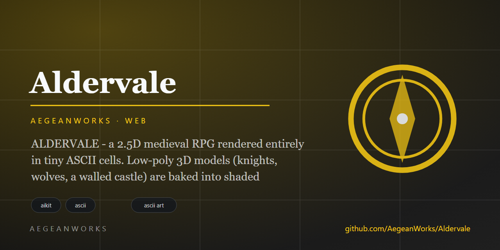
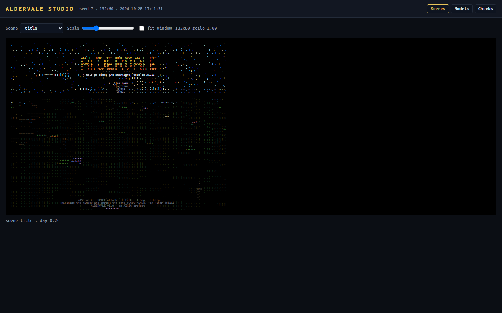

# aldervale

<!-- aegean:media:start -->
<p align="center"></p>
<p align="center"><a href="LICENSE"></a> <a href="https://github.com/AegeanWorks/AIKit"></a></p>
<!-- aegean:media:end -->


ALDERVALE - a 2.5D medieval RPG with three renderers over one engine: a GPU
WebGL2 build, a software pixel build and a dense ASCII terminal build. Low-poly
3D models (knights, wolves, a walled castle) are baked into RGBA sprites or
character cells, or streamed as meshes to the GPU, over a voxel heightfield with
fog, day/night light, weather and water, and composited with a full RPG on top:
quests, combat, loot, shops, saves.

The browser opens on a high-resolution WebGL2 canvas through a localhost thin
client; `/play` keeps the software pixel renderer as a fallback, and the terminal
build keeps the character-cell view. All run the same Python World, Game and
HUD. Standard library only; no dependencies, no assets, no build step.

## 30-Second Cold-Start Quick Reference

- **Runtime Prerequisites**: Python 3.10 or newer (standard library only). The
  GPU build needs a WebGL2 browser; the software pixel build at `/play` needs
  only canvas 2D. `PLAY_WEB.bat` opens the GPU build. The terminal build needs a
  dark-theme terminal with 24-bit colour (Windows Terminal, Terminal.app or any
  modern xterm); PLAY.bat opens a dedicated maximized Windows Terminal window,
  and the ASCII renderer scales with the window up to 260x110 cells.
- **Canonical Regression Shield Gate**:
  ```bash
  python -m unittest discover
  ```
- **Run something now** (under 10 seconds):
  ```bash
  PLAY_WEB.bat    # Windows: double-click for GPU 3D in the browser
  ./play_web.sh   # macOS and Linux: GPU 3D in the browser
  python -m aldervale --serve --open-play # GPU 3D browser game (same engine)
  python -m aldervale --serve --open # launcher: 3D / pixel / terminal / Studio
  python -m aldervale --gfx-shot frame.png --gfx-scene village
  PLAY.bat        # Windows: the ASCII terminal build
  ./run.sh        # macOS and Linux: the ASCII terminal build
  python -m aldervale --demo 9      # hands-free ASCII attract mode
  python -m aldervale --screenshot vista.txt && type vista.txt
  python -m aldervale --inspect .inspect # 19 ASCII PNG images + 17 control checks
  python -m aldervale               # terminal play (WASD, SPACE, E, I, H)
  ```

  In VS Code, open the project folder and press F5 (or the Run button) -
  `ALDERVALE: Play` and `ALDERVALE: Demo` configurations are included.

### AIKit Commands (run from the AIKit folder)
| Role | Command |
|---|---|
| Status, task and gates | `python aikit.py status aldervale` |
| Phase 4: every gate | `python aikit.py check aldervale` |
| Repair memory and map, then check | `python aikit.py fix aldervale` |
| Resume an interrupted task | `python aikit.py resume aldervale` |

## The Tale

The Suncrest Amulet, hearth-stone of the vale, was stolen by the Bone Captain
and now squats in the old camp beyond the eastern woods. Elder Quill waits by
the village shrine; Bram hammers steel at his forge; wolves and worse patrol
the trees. Slay the Captain, bring the amulet home, and Aldervale will call
you hero. Full cycle: talk, accept, fight, loot, equip, buy, return, victory.

That is the tale the villagers tell. The true canon - the First Fire, the
eleven Keepers, the Captain's grief, the wyvern's vigil, and where the saga
goes next - is written in **LORE.md**, the Chronicle of the vale. Every story
change to the game builds on it, and **ADAPTATION.md** maps every canon
element to the exact file that owns it.

## Graphics

The browser has two renderers; the terminal keeps a third. All read the same
world, camera, meshes and clock.

### GPU 3D (browser, `PLAY_WEB.bat` / `/play3d`)

- A WebGL2 canvas draws the world at native window resolution with smooth
  terrain, perspective-correct models, a sky gradient, a moving water plane and
  a transparent text HUD.
- The heightfield and a lit RGBA material map are uploaded once as textures.
  A 320x320 terrain grid is displaced in the vertex shader and lit/fogged in
  the fragment shader; no per-pixel ray march is needed.
- One triangle-soup bundle carries all 41 models and 88 poses (~2.4 MB). The
  browser instantiates the real meshes for every visible actor, prop, tree and
  building, so there is no billboard LOD in this build.
- Each tick sends a compact scene description (camera, visible entities, tint,
  HUD text) rather than a pixel frame; the Python simulation remains
  authoritative.
- A 1024x1024 directional shadow map covers the area around the camera; the
  terrain depth pass culls front faces to avoid self-shadow acne, and PCF
  sampling softens the model and house shadows. Night adds stars and a moon;
  rain and snow are GPU overlays driven by the world weather.
- Up to six nearby point lights from campfires, torches, shrines and house
  windows warm the terrain and models at night; the water shader fades into
  shoreline foam and a drifting procedural cloud layer crosses the sky.
- A soft additive halo, scaled by darkness and flicker and skipped in menus,
  surrounds those lights; the campfire now has an ash bed, a stone ring,
  charred logs with ember tips and four flame tongues, and the gate torch has
  a pronged iron basket with stacked flame cones.
- Cottage roofs stack six thatch rows per slope in alternating straw tones
  under a rounded ridge with end caps, with eaves fascia, four corner brackets
  and a chimney pot. Every cottage sends its chimney position with the scene,
  and the browser drifts four soft puffs above it, so the skyline moves by day
  and night.
- Rain darkens figures and roofs and adds a wet sheen; snow caps up-facing
  surfaces, while fire and torch flames stay clear. Fires, torches and windows
  flicker.
- Rain and snow grade the whole scene: overcast sky, dimmer sun, closer fog,
  hidden stars and drifting cloud shadows.
- The sky layers drifting clouds with sun-lit edges and wide sun/moon halos;
  rain adds brief lightning flashes.
- Water reflects the horizon at grazing angles, catches a sun glint, deepens
  from turquoise shallows to blue, and shows rain ripple rings.
- The colour texture carries a material id: the terrain shader adds
  grass/forest/road/rock/snow grain, flower flecks and wet/snow response.
- The HUD minimap is a real terrain map with water, roads, entity dots and
  a gold player marker, replacing the ASCII map in the GPU build.
- The GPU HUD uses a graphical status panel: name, level, gold, HP/STA/XP
  bars, weapon and armor, potions and the quest line. The ASCII status block is
  suppressed while messages and the location plate stay; small stages fall back
  to the ASCII HUD.
- Click-to-walk uses a CPU heightfield raycast on the server; movement, combat,
  shops, dialogue, saves and the HUD are the same code as the other builds.
  The ASCII minimap is suppressed in the GPU build so the browser map owns
  that corner.
- `http://127.0.0.1:PORT/play3d?weather=rain&day=0.8` previews a scene; the
  query is applied when the GPU session is first built.

### Pixel graphics (browser, `/play`)

- A 288x162 truecolor software frame buffer is upscaled with nearest-neighbour
  sampling, retaining the pixel-art fallback for machines without WebGL2.
- The same low-poly meshes are baked once into square-pixel RGBA billboards at
  4-12 yaw frames per pose, with Gouraud face shading, a metallic specular,
  silhouette outlines and a separate additive glow layer for fire and windows.
- Nearby characters and the closest props are drawn from the actual meshes:
  perspective projection, backface culling, world-space sun lighting, a 1px
  silhouette outline and the shared terrain z-buffer.  The player is always
  drawn in 3D and composited with a small depth bias so a foreground terrain
  crest cannot slice its legs; the nearest four actors and two props join it,
  and everything farther away falls back to baked billboards, so the frame
  stays cheap.
- Square-pixel baking keeps billboard and mesh proportions aligned: a knight
  is as tall at 30 m as the same knight is when the runtime renderer picks up
  the mesh at 12 m.
- Sun-cast shadows stretch from nearby actors, props and trees and are clipped
  against the terrain depth buffer; large ground runs get a subtle
  world-anchored grain instead of a flat slab, and water reflects the horizon
  colour toward the far shore.
- Rounded mesh parts (helms, pauldrons, wolf bodies, tree canopies) use
  Gouraud shading across their vertices; flat plates and cloth stay faceted so
  the low-poly style remains intentional.
- Terrain is a per-column ray-march over the heightfield: each material has a
  lit colour palette, coherent texture and per-cell grain, adjacent spans merge
  into colour runs before filling to suppress banding, and distance fog, water
  ripples, shoreline foam, rain and snow are mixed per pixel.
- The sky has a vertical gradient, sun/moon discs with a halo, stars, thin
  drifting cloud wisps, three fogged mountain ridges and crossing birds.
- Campfires, torches, shrines and cottage lanterns add warm light pools;
  every figure gets a contact shadow; fireflies appear at night; a hurt
  vignette is drawn into the frame itself.
- The RPG interface stays the existing text HUD, composited over the pixels by
  the browser; modal screens dim the world and text gets a dark outline.
- `python -m aldervale --gfx-shot frame.png --gfx-scene village` writes one
  pixel frame with no terminal or browser, and `--gfx-size WxH` selects the
  internal resolution.

### ASCII graphics (terminal, `PLAY.bat`)

- a 19-level glyph ramp (space through `$`) shades every face;
- terrain has a per-cell material grid (sand, grass, forest, dirt, rock, snow)
  and a coherent two-octave texture grid; each material draws from a weighted
  16-slot glyph table, so grass shows tufts, roads show gravel, cliffs show
  broken stone instead of one repeated character;
- the sky has a warped 8x8 dither and three fogged ridges; water mixes
  ripples, foam, a faint sun/moon glitter path and calm troughs;
- near ground detail: grass tufts, tinted flowers, pebbles, broken rock,
  snow sparkle and shells on their own materials;
- every billboard casts a dithered contact shadow and a sun-direction shadow;
  campfires, gate torches, shrines and door lanterns light the ground;
- sprite baking draws line art only on meaningful face boundaries (`|`, `-`,
  `+`), adds a metallic specular and a cool shadow tint, and the downsampler
  uses a smooth mean glyph with the highest-contrast cell colour so plate,
  cloth and blade edges survive;
- cottages carry stone footings, timber braces, layered thatch, a capped
  chimney, flower boxes and a lit door lantern; wells have a pulley, rope and
  bucket; boulders are rounded ellipsoids;
- a deterministic clear/rain/snow cycle, persisted in saves, with in-world
  messages and a weather label on the location plate;
- the inspect harness renders the ASCII view at 132x60, 80x40 and 40x20 without
  a terminal.

## Controls

| Key | Action |
|---|---|
| Title: Up Down + Enter | choose a menu option (clicking it works too) |
| N C H Q | new game / continue / help / quit from the title |
| W S or Up Down | walk forward / back |
| A D | sidestep left / right |
| Left / Right | turn the camera |
| Right-drag mouse | orbit and tilt the camera (full 3D look) |
| Left-click | walk to a point; talk to what you reach; attack a foe in reach |
| Mouse wheel | zoom the camera |
| Hold Shift | sprint (drains stamina) |
| SPACE | swing your sword (backstabs deal +50% from behind a foe) |
| Hold B | guard: blocks most incoming damage, spends stamina on each hit |
| E or Enter | talk / open chest / pick up / pray at shrine |
| I | inventory (U use potion over a few seconds, E equip best) |
| M | toggle minimap |
| H or F1 | help |
| + / - | zoom the camera (keys) |
| ESC | pause (save & quit from there) |

## Command Line

```text
python -m aldervale [--seed N] [--width W] [--height H] [--fps N]
                    [--demo [SECS]] [--benchmark] [--no-color]
                    [--screenshot PATH] [--gfx-shot PATH]
                    [--gfx-scene NAME] [--gfx-size WxH] [--inspect DIR]
                    [--inspect-scale N] [--web-shot PATH]
                    [--web-dir DIR] [--web-query QUERY]
                    [--web-size WxH] [--serve [PORT]] [--open]
                    [--autostart] [--open-play] [--save PATH] [--version]
```

`--demo` runs a non-interactive attract mode (also works piped, for CI);
`--benchmark` renders 60 headless ASCII frames and reports timing (~23 ms/frame
at 132x60 on a 2026 laptop); `--screenshot` writes one plain-text ASCII vista;
`--gfx-shot` writes one truecolor pixel frame to a PNG (`--gfx-scene` picks the
scripted camera, `--gfx-size` the internal resolution).
Exit codes: 0 success, 1 failure (What/Why/Fix on stderr), 2 misuse.

### Seeing the game without a terminal

`--inspect DIR` boots the ASCII renderer headlessly and writes the views a
reviewer or an AI agent needs to debug the terminal build. For the pixel build,
use `--gfx-shot` (one frame) or `--serve --open-play` and capture the canvas
(this is the authoritative graphics view).

- nineteen PNGs: seventeen scenes (world, castle day/night, camp night,
  cottage, rain, snow, combat and menus) plus `15_sprites.png` and
  `16_portraits.png` for figure review;
- a `.txt` mirror per scene: the exact glyph grid, a colour-class map and the
  dominant palette, readable in any editor or terminal;
- `report.json` with per-scene fill/colour statistics and the results of 17
  scripted checks (walk, strafe, turn, sprint, guard, attack, potion, menus,
  map, zoom, orbit, click-to-walk, key mapping, respawn, buy, sell); the
  command exits 1 if any check fails, so it doubles as a control gate.

Menus clamp to the viewport: help and inventory wrap, the shop drops its
description column, and the title uses a compact banner on small windows.
`--inspect-scale 2` sets PNG crispness; write under the project (`.inspect/`
is gitignored).

### Studio: the accurate browser lens

The PNG writer uses a small built-in bitmap font and tinted cell backgrounds,
which is handy but not pixel-faithful. Every `--inspect` run also writes
`index.html` + `studio-data.js`: a standalone Studio that renders the exact
character/colour grid with a real monospace font on black. It has three tabs:

- **Scenes** - all captured frames, zoom and fit;
- **Models** - 8 models/poses at 8 yaws, 1-8x, grid, spin and a 4x2
  all-yaws turnaround;
- **Checks** - the 17 probe results.

Open the page directly, or capture it with headless Edge/Chrome:

```text
python -m aldervale --web-shot shots/knight.png --web-dir .inspect \
  --web-query "tab=models&model=knight&pose=idle&yaw=0&scale=4&shot=1" \
  --web-size 1200x1200
python -m aldervale --web-shot shots/village.png --web-dir .inspect \
  --web-query "tab=scenes&scene=village&shot=1" --web-size 1600x1000
```

`--web-shot` drives installed Edge/Chrome (override with `ALDERVALE_BROWSER`)
with no Python dependency. Its DOM text matches the terminal grid exactly, so
this is the authoritative view; PNG/txt remain for browserless tooling.

### Browser edition (same engine, GPU 3D + pixel fallback)

```text
PLAY_WEB.bat                          # Windows: one click, GPU 3D
sh play_web.sh                        # POSIX: one command, GPU 3D
python -m aldervale --serve --open-play
```

`/play3d` runs the **same Python World, Game and HUD** as the terminal; the
browser sends keyboard/mouse state and receives a compact scene description,
then draws the heightfield, water and real model meshes in WebGL2 with a text
HUD overlay. The GPU forge is about a second, and rendering is uncapped in the
browser (the simulation still ticks at 20 fps). WASD/arrows, SPACE, SHIFT, B,
E, I, M, H, ESC, click-to-walk, right-drag look and wheel zoom all work. GPU
saves use `saves/aldervale_web3d.json`.

`/play` is the software pixel fallback with the same simulation, HUD and
controls; it saves to `saves/aldervale_web.json`. Both builds run the same
simulation step, so menus freeze the world, death offers respawn and the victory
banner appears in the browser exactly as in the terminal. The terminal version
keeps the ASCII renderer: `PLAY.bat` or `python -m aldervale`.

The server binds `127.0.0.1` only. The pixel and GPU sessions each pause after
20 s without a browser poll and resume on the next request. Opening a second
tab for the same page attaches to that session. Expose the port deliberately if
you want LAN play; there is no account system.

### Launcher: terminal, browser and Studio in one page

```text
python -m aldervale --serve --open
```

**PLAY GRAPHICS 3D** opens the WebGL2 build at `/play3d`; **PLAY PIXEL** opens
the software fallback at `/play`; **START GAME (TERMINAL)** opens the native
ASCII game in a new console (Windows); **WATCH DEMO** runs the attract mode;
**Open Studio** serves the inspection Studio at `/studio/`.
`--open-play` opens the browser game directly, while `--autostart` opens the
launcher and starts the native game immediately. If a launcher is already
running, the same command only reopens the page. Ports below 1024 are refused;
use `--serve PORT` to pick another. Only fixed launch commands are exposed and
`/start` + `/api/input` require the per-process token.

## What's Inside

```text
aldervale/
├── PLAY.bat            <- one-click launch on Windows (prefers Windows Terminal)
├── PLAY_WEB.bat        <- one-click browser game (starts the localhost server)
├── run.sh              <- one-command launch on macOS and Linux
├── play_web.sh         <- one-command browser game for POSIX
├── .vscode/
│   └── launch.json     <- F5 / Run button configurations for VS Code
├── aldervale/
│   ├── __init__.py       <- package marker and version
│   ├── __main__.py     <- CLI: play, demo, screenshot, inspect, triads
│   ├── term.py         <- VT100 terminal control, non-blocking key input
│   ├── buffer.py       <- char-cell screen: colour, depth, diff flush
│   ├── gfx.py          <- truecolor pixel framebuffer and sprite pixels
│   ├── gfxatlas.py     <- bakes meshes into RGBA billboards for the browser
│   ├── gfxmodels.py    <- runtime 3D mesh rasteriser for nearby actors/props
│   ├── gfxrender.py    <- pixel sky, terrain, billboards, lights, weather
│   ├── webglscene.py   <- GPU world/model bundles and scene encoder
│   ├── webglclient.py  <- WebGL2 page: terrain, water, models, HUD overlay
│   ├── capture.py      <- Screen to truecolor PNG with a built-in 5x7 font
│   ├── inspect.py      <- scene PNGs, text mirrors and the control probe
│   ├── studio.py       <- exact browser studio, model viewer, headless shots
│   ├── webgame.py      <- browser play session, canvas client, frame transport
│   ├── launcher.py     <- localhost launcher: start page, token, /play and Studio
│   ├── math3d.py       <- vector/matrix helpers for the sprite baker
│   ├── noise.py        <- deterministic integer-hash value noise
│   ├── terrain.py      <- island heightfield, biomes, paths, light
│   ├── mesh.py         <- box/cone/cylinder/sphere builder + ASCII baker
│   ├── models.py       <- knight, wolf, skeleton, castle, trees, houses...
│   ├── atlas.py        <- bakes every (model, pose, yaw) into sprites
│   ├── render.py       <- sky, sun, clouds, voxel terrain, billboards
│   ├── entities.py     <- actors, props, pickups, AI state machines
│   ├── rules.py        <- items, damage, XP, inventory (pure functions)
│   ├── story.py        <- the Chronicle as data: cast, dialogue, quests
│   ├── world.py        <- generation, quests, dialogue, shops, saves
│   ├── hud.py          <- bars, minimap, menus, dialogue, title art
│   └── game.py         <- game states, camera, main loop, demo autopilot
├── tests/
│   ├── __init__.py          <- test package marker
│   ├── test_aldervale.py    <- unit tier: pure engine core (fast)
│   └── test_integration.py  <- world gen, quest chain, rendering, CLI
├── LORE.md             <- the canon: world, history, characters, open threads
├── ADAPTATION.md       <- canon to code: where story changes go and why
├── .aikit/             <- this project's memory: record, ledger, decisions
├── .gitignore
├── assets/
├── COMMERCIAL.md       <- Commercial licensing terms (ACL-1.0)
├── LICENSE             <- Aegean Game License 1.1 (AGL-1.1): DRM-free personal play
├── LICENSES/           <- REUSE license texts
├── REUSE.toml          <- Machine-readable SPDX metadata
├── ASSETS.md           <- Asset/data manifest: what the license covers
└── README.md
```

(`saves/` appears next to the executable once you save a game; it is
gitignored.)

## Technical Notes

- The GPU build uploads a 320x320 height texture, a lit RGBA material texture and a ~2.4 MB triangle-soup model bundle once, then renders a displaced terrain grid, a water plane and real model instances in WebGL2. Each 20 fps tick sends a small scene JSON instead of a pixel frame; a server-side heightfield raycast resolves click-to-walk.
- The pixel build renders into a 288x162 column-major RGB buffer. A per-column
  ray-march over the height grid fills vertical runs and a per-pixel depth
  buffer, terrain spans merge into colour runs, and the nearest actors and
  props are rasterised from their real meshes with backface culling and
  world-space lighting.  Distant entities are depth-tested RGBA billboards
  baked from the same meshes at 4-12 yaw frames per pose. Rounded faces use
  precomputed vertex normals and Gouraud shade tables, while sun-cast shadows
  and a light world-anchored ground grain break up large flat spans. The
  browser receives the raw frame plus the text HUD, upscales the pixels with
  nearest-neighbour sampling and draws HUD glyphs on top, so menus and status
  text stay crisp.
- The terminal build is the original 2.5D composite: a per-column ray-march
  draws terrain, water and fog; entities are depth-tested character-cell
  billboards with silhouette outlines; emissive faces bloom at night. The
  camera orbits and tilts freely, and clicking the world walks there by reading
  the depth buffer.
- Terminal frames are emitted as foreground-only truecolor runs of changed
  cells, so HUD rows cost nothing and full-motion frames stay small. Browser
  frames are sent as base64 column-major RGB plus the HUD grid.
- Everything is deterministic from `--seed`: terrain, village layout, spawns,
  and the rng behind combat rolls.

<!-- aegean:brand-assets:start -->
## 🎨 Brand Assets

> **AI-Generated Brand Artwork.** The banner and logo are **AI-generated brand assets**. They are illustrative and may not literally depict every feature or the full project scope.
<!-- aegean:brand-assets:end -->

## 📜 License

Free for personal play under the Aegean Game License 1.1 (AGL-1.1); see [LICENSE](LICENSE). It is DRM-free: Licensor ships no DRM and a distributor may not add it. Streaming, modding and free mods are allowed. Commercial use, paid mods and AI training need the Aegean Commercial License 1.0 (ACL-1.0); see [COMMERCIAL.md](COMMERCIAL.md).

<!-- aegean:screenshots:start -->
## Screenshots

<a href="https://github.com/AegeanWorks/Aldervale/commit/6c90987"></a>

*commit `6c90987` · 2026-10-28*
<!-- aegean:screenshots:end -->
